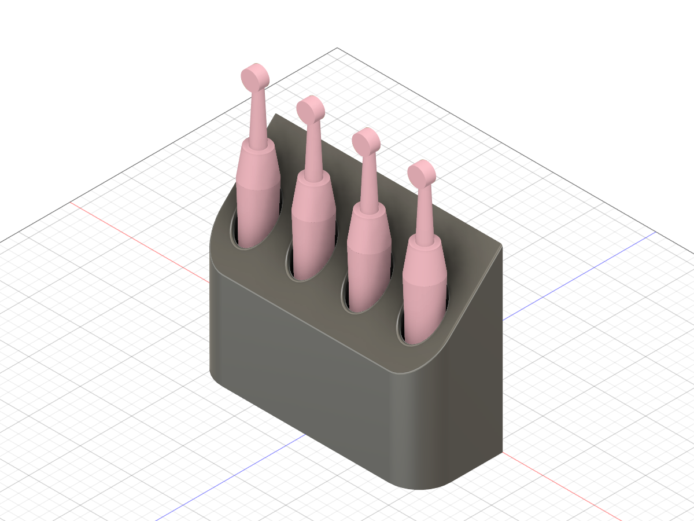
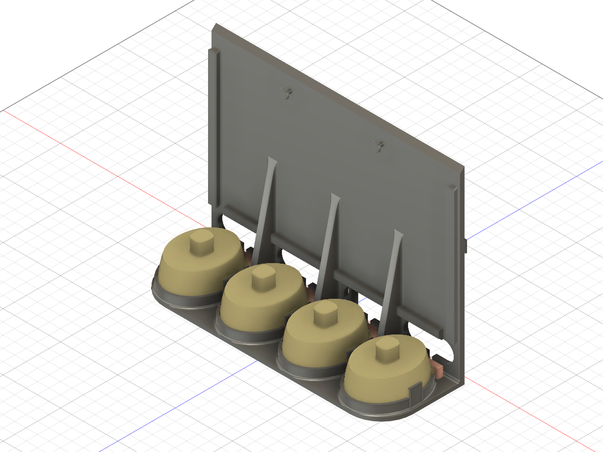
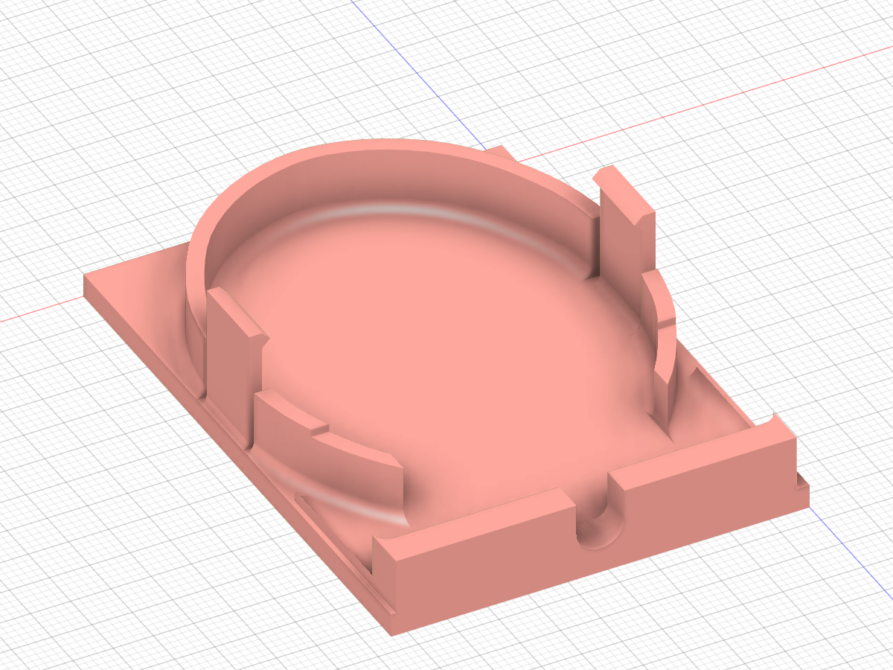
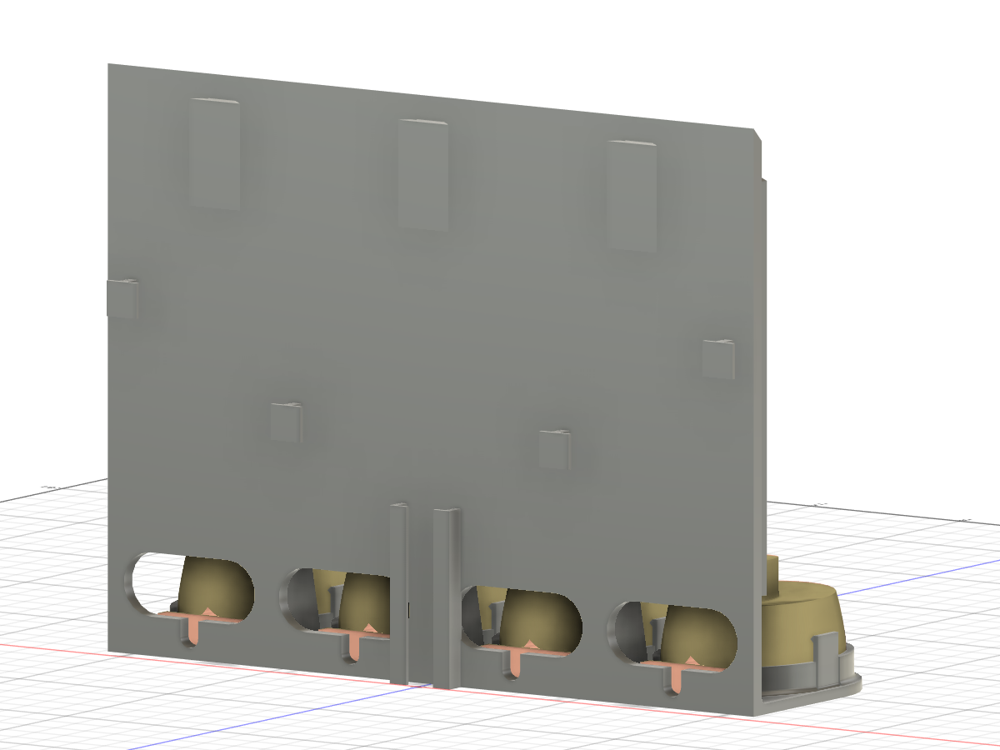
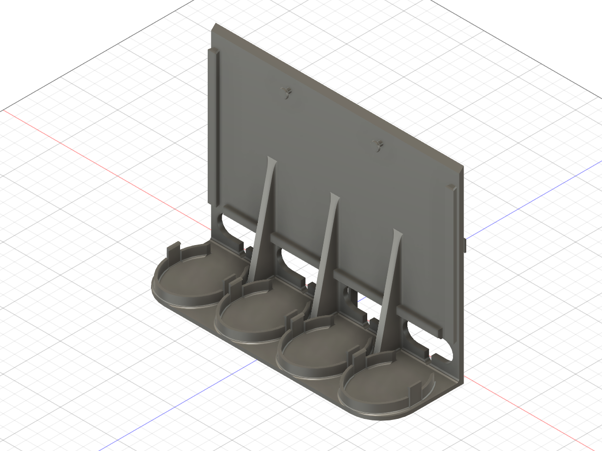
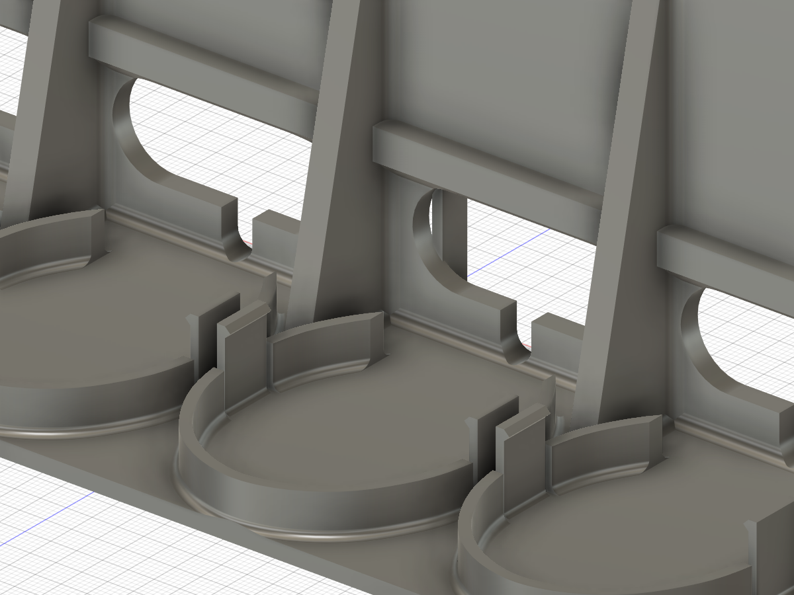

# Oral-B wall holder for four brushes

A wall-mounted holder after the concept renders: a closed box with a sloped top and
four round openings, in three parts. All four chargers are hidden inside, and their cords leave
through the back wall into a channel behind it, where they run together as one bundle. It is
built in Fusion by `wall_holder_fusion.py`. The charger sizes are measured: 46.7 mm wide,
59.7 mm long without the cord tab, 24.3 mm tall, with a 30 × 3.6 mm tab at the back. Its
outline is the scan's from the Fusion design, scaled to those sizes. The brush handle is
measured too: Ø25 at the bottom, 28 × 29.3 mm at 97 mm up, 30.4 × 31.3 mm at 131 mm up. The plug
(44 × 35 × 13 mm) comes from the scan.

## Parts

- **Wall plate.** Screwed to the wall.
- **Base** (back wall and bottom plate). Slides down onto the plate and carries the chargers.
- **Cover** (front, sides and sloped top with the brush tubes). Slides down onto the base on
  two dovetail rails and closes the box right up to the wall.

To clean out water and toothpaste, take the brushes out, lift the cover about 150 mm and take
it off forwards; the chargers and their cords stay where they are. Lifting the base 30 mm takes
the rest off the wall.

| File | Part | Size | Prints |
|---|---|---|---|
| `wall_holder_cover.stl` | Cover | 222 × 81 × 175 mm | standing on its open bottom, as exported |
| `wall_holder_base.stl` | Base: back wall + bottom plate | 217 × 78 × 165 mm | standing on its plate, as exported |
| `wall_holder_plate.stl` | Wall plate | 180 × 33 × 6 mm | flat on its back, as exported |
| `wall_holder_cradle_test.stl` | Fit test: one cradle with its spring tongues, its piece of the plate and 10 mm of the back wall with the cord slot | 52 × 72 × 18 mm | flat on its plate, as exported |
| `wall_holder.step` | All three bodies, as assembled | | |
| `wall_holder_fusion.py` | Builds the component "Wall holder" in the active Fusion design | | |

- **Overall.** 222 × 81 mm in plan, front corners R30. The back is 175 mm high and the front
  94 mm, and the top is a 45° slope with R2 edges (sharp where it meets the wall). The slots
  are at a 54 mm pitch, 45.8 mm from the wall. The cord tab ends 2.3 mm in front of the
  base's back wall, clear of the corner fillet. Seen from above, the openings keep about 18.7 mm
  to the front edge (the charger's length sets that) and 13.5 mm to the sides.
- **Cover.** 2.4 mm walls, open at the bottom and at the back. Its sides and roof run right up
  to the wall, so they hide the base's back wall and the cord channel behind it. Under each
  Ø33 opening (R2.5 lead-in) a tube runs down to 4 mm above the charger top. At its bottom a
  Ø26.5 ring centres the Ø25 brush foot over the peg (0.7 mm play), widening in a 10 mm cone
  to the bore. Under the roof the handle is at most about 30.7 mm wide, so it keeps at least
  1.3 mm of clearance all round.
- **Wall plate.** 180 × 33 × 6 mm, after the wall plate of the original three-brush holder, only thinner. It takes two countersunk Ø4 wood screws at x ±45. In its front are three
  vertical dovetail grooves (x −70, 0, +70; 10 mm wide at the face, 45° flanks, 4 mm deep). The
  grooves are open at the top and have a 3 mm floor at the bottom. Its top is 158 mm above the
  holder's bottom edge.
- **Base.**
  - Back wall: 4 mm thick, standing 6 mm off the wall, with its top under the cover's roof.
    Three dovetail tongues on its back slide down into the plate's grooves (0.3 mm clearance)
    and sit on the groove floors.
  - Bottom plate: 3 mm, inside the cover walls with 0.25 mm all round.
  - Gussets: three 5 mm gussets tie the plate to the back wall in the webs between the cord
    holes (x 0 and ±55), 20 mm along the plate (stopping short of the cradles) and 90 mm up
    the wall. They carry the weight
    of the chargers and brushes.
  - Stiffening rib: a 6 × 4 mm rib runs along the front of the back wall just above the cord
    holes (31 mm up). It ties the webs together and gives back the stiffness the holes take
    away.
  - Inside corners are rounded where they carry load:
    - back wall to plate R2.2 (R3 would touch the cord tabs), gussets to the wall R2.2, gussets
      to the plate R1.5;
    - a 3.5 mm 45° chamfer under the rib, which also takes away its overhang in print;
    - cradle walls to the plate R1.5, inside and out (the charger's own bottom edge is R4);
    - spring tongue roots R1;
    - in the cover, the rail posts to the side walls R2.
  - Mating faces stay sharp: dovetails, grooves and clamp pins only have their lead-in
    chamfers.
- **Cords.** Behind each charger a 44 × 18 mm obround hole (11–29 mm up) goes through the
  back wall, behind the cord tab. The holes start at the height of the cradle walls, so a plug
  slides straight in over the cradles and through. Under each hole a 6 mm slot runs down to
  the plate, right behind the tab. The cord leaves the tab level and goes straight out through
  it; the corner fillet is cut away in front of the slot. The inner two holes sit 2 mm outboard of their chargers (x ±29), so there is
  room for the channel between them; the outer two sit right behind theirs (x ±81). A plug goes through a hole end first. Behind the back
  wall, the 6 mm gap to the wall holds the cords:
  - Each cord comes out of its hole, loops up over a T-hook (x ±45 at 65 mm up for the inner
    chargers, x ±100 at 95 mm for the outer ones), and comes down into the channel. Any slack
    winds round the hooks.
  - The channel runs down the middle from 50 mm to the bottom edge. Two strips with 3.5 mm
    lips leave it 16 mm wide, so the four cords (Ø3.7) lie in it flat, side by side, and leave
    at the bottom as one bundle.
  - Hooks and strips stop 0.5 mm short of the wall. Behind the lips there is 4.3 mm for the
    cords.
  - The upper hooks sit outboard of the wall plate, so they do not stop the base lifting off.
- **Charger cradles.** Each charger clicks into a cradle on the plate:
  - The wall is 2 mm thick and 8 mm high and follows the charger's widest outline, 0.3 mm
    off it. It has a 33 mm notch at the back for the 30 mm cord tab, and at the front it is
    trimmed to the plate edge (about 2 mm left there).
  - On both long sides a spring tongue (1.6 × 10 mm, 15 mm tall) carries a hook. The hook
    sits 14 mm up, on the charger's side where it already tapers (about 9° per side above its
    widest band).
  - Seated, the hooks squeeze the charger by about 0.1 mm and press it down onto the plate.
    Pushing it in or pulling it out bends each tongue at most about 0.6 mm (well under 1 %
    strain).

- **Rails.** Two vertical dovetail rails on the front of the back wall (x ±103.6, 5 → 7.5 mm
  wide, 4 mm deep) run from 33 mm up to 150 mm. They start above the cord holes and the rib,
  so the outer holes can sit right behind their chargers. They slide in grooves in two 12 × 10 mm
  posts that run up inside the cover's back corners into its roof.
  - The clearance is 0.3 mm per side, and the rail tops and groove mouths have 0.8 mm lead-in
    chamfers.
  - The grooves are closed at the top, so the cover hangs on the rail tops with its bottom
    edge level with the plate.
- **Top clamps.** Two Ø4 pins on the back wall (x ±40, 150 mm up) have 45° conical heads.
  - Two tabs under the cover's roof come down in front of them, each with a slot open at the
    bottom and a wedge on its front face (1.9 → 2.9 mm thick).
  - In the last 3 mm of the cover's travel the pin heads run up the wedges; seated, they
    squeeze the tabs 0.15 mm against the back wall, which takes up the rails' play.
  - Above the pin head a 45° gusset ties each tab into the roof.
- **Checked in the model:**
  - nothing overlaps when assembled, apart from the intended squeeze at the clamp pins and the
    charger hooks;
  - the cover lifts straight up and is free to come forward only after about 148 mm;
  - the base lifts off the plate after 30 mm, and while its tongues are in the grooves it
    cannot come forward;
  - a plug (44 × 35 × 13 mm, R2 corners) pushed straight in from inside the box passes over the
    cradles and through every cord hole;
  - a Ø4 cord runs straight back from each tab through its slot;
  - the base lifts off the plate without the hooks catching on it;
  - the tubes clear the chargers all the way up.

Printing on the Bambu Lab P2S (0.4 nozzle): `Wall holder - 0.20mm @BBL P2S.json` is a process
preset based on `0.20mm Standard @BBL P2S` (import it through File → Import → Import Configs…).
It sets 3 walls, 4 top and bottom layers, 15 % gyroid infill, the seam at the back, no
supports and no brim. The stock `0.20mm Standard @BBL P2S` works as well, as long as supports
are off. PETG suits the spring tongues and the bathroom better than PLA; print the fit test in
the same filament as the final base.

Print `wall_holder_cradle_test.stl` first, flat on its plate as exported: it needs no supports
(the hooks have 45° ramps on both sides). Check that the charger clicks in, sits without play,
comes out with a firm pull, and that its cord leaves straight back through the slot.

Print the cover with tree supports under the sloped top and the tube bottoms. The base prints
standing on its plate, so the cradles and tongues come out vertical. The clamp pins point
forward; their heads are 45° cones, and the shanks print as short horizontal cylinders. The
dovetail tongues, the hooks and the channel strips on the back are vertical too. The wall plate prints flat on its back; its
groove flanks are 45° overhangs.
